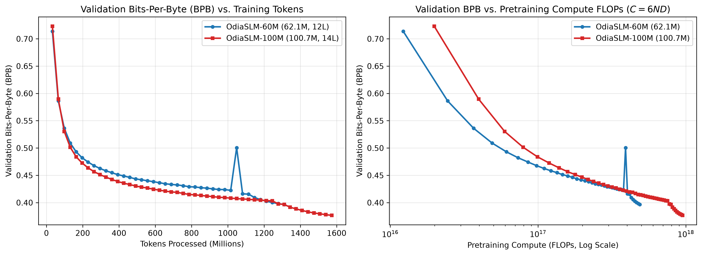
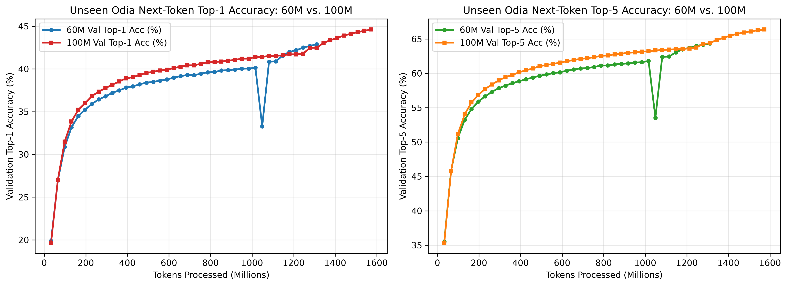
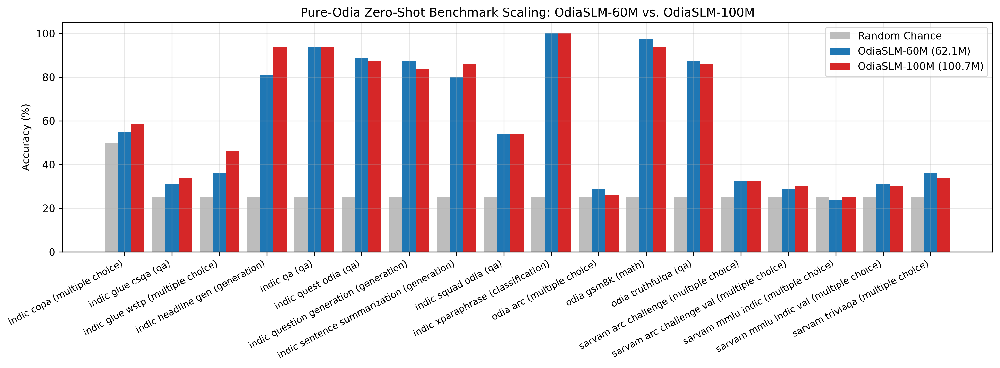

# OdiaSLM: Sovereign 60M & 100M Small Language Models for Odia (ଓଡ଼ିଆ)

[](https://doi.org/10.5281/zenodo.24167433)
[](https://huggingface.co/arunjmisra2273/OdiaSLM-100M-Base)
[](https://huggingface.co/arunjmisra2273/OdiaSLM-60M-Base)
[](LICENSE)
[](LICENSE)

**Author:** Arun Misra (AI Researcher, Bhubaneswar, Odisha, India)  
**Paper Preprint:** [OdiaSLM_Preprint_Misra_2026.pdf](paper/OdiaSLM_Preprint_Misra_2026.pdf) | **DOI:** [10.5281/zenodo.24167433](https://doi.org/10.5281/zenodo.24167433)

---

## Overview

**OdiaSLM** is an end-to-end pretraining, morphology-aware tokenization, and calibrated zero-shot evaluation framework for the **Odia language (`or`, ଓଡ଼ିଆ)**. We train two decoder-only Small Language Models from scratch on up to **1.57 Billion tokens** drawn from a strictly deduplicated and 13-gram benchmark-decontaminated corpus of **9,619,050 documents (1.247 Billion words)**:

- **[`OdiaSLM-60M-Base`](https://huggingface.co/arunjmisra2273/OdiaSLM-60M-Base):** `62,111,360` parameters (`12` layers, `640` hidden, `10Q/2KV` GQA, `1728` SwiGLU) -> **Val PPL `19.92` | BPB `0.3965` | Pure-Odia Zero-Shot `59.65%`**
- **[`OdiaSLM-100M-Base`](https://huggingface.co/arunjmisra2273/OdiaSLM-100M-Base):** `100,685,568` parameters (`14` layers, `768` hidden, `12Q/4KV` GQA, `2048` SwiGLU) -> **Val PPL `17.14` | BPB `0.3767` | Pure-Odia Zero-Shot `60.83%`**

Both models export with `0.00e+00` float32 logit parity into native Hugging Face `LlamaForCausalLM` (`model.safetensors`) format and run with **`trust_remote_code=False`**.

---

## Scaling Laws & Benchmark Highlights (60M vs. 100M)





| Metric / Benchmark | `OdiaSLM-60M-Base` | `OdiaSLM-100M-Base` | Scaling Improvement |
| :--- | :---: | :---: | :---: |
| **Trainable Parameters** | `62,111,360` | **`100,685,568`** | `+62.1%` capacity |
| **Pretraining Tokens Processed** | `1.31B` (`10,000` steps) | **`1.57B` (`12,000` steps)** | `+262.1M` tokens |
| **Tokenizer Fertility (Odia)** | `1.4809 tok/word` | **`1.4809 tok/word`** | `3.6x` over Multilingual LLMs |
| **Global Validation Loss (CE)** | `2.9917` | **`2.8417`** | **`-0.1500` nats/token** |
| **Global Validation Perplexity (PPL)** | `19.92` | **`17.14`** | **`-13.9%` PPL reduction** |
| **Global Validation Bits-Per-Byte (BPB)** | `0.3965` | **`0.3767`** | **`-0.0198` BPB** |
| **Unseen Validation Top-1 / Top-5 Acc** | `42.89%` / `64.34%` | **`44.61%` / `66.38%`** | **`+1.72%` / `+2.04%`** |
| **Pure-Odia 18-Task Macro Avg (Calibrated)** | `59.65%` | **`60.83%`** | **`+34.44%` over chance** |
| **All 27 Tasks Macro Avg (Calibrated)** | `55.26%` | **`56.83%`** | **`+30.01%` over chance** |

---

## Quickstart: Inference with Hugging Face `transformers`

```python
import sentencepiece as spm
import torch
from huggingface_hub import hf_hub_download
from transformers import AutoModelForCausalLM

repo_id = "arunjmisra2273/OdiaSLM-100M-Base"  # or "arunjmisra2273/OdiaSLM-60M-Base"
tok_path = hf_hub_download(repo_id=repo_id, filename="tokenizer.model")
sp = spm.SentencePieceProcessor(model_file=tok_path)

model = AutoModelForCausalLM.from_pretrained(
    repo_id,
    dtype=torch.float16 if torch.cuda.is_available() else torch.float32,
    trust_remote_code=False,
)
model.eval()

prompt = "ଓଡ଼ିଶାର ରାଜଧାନୀ ଭୁବନେଶ୍ୱର ଏକ"
input_ids = torch.tensor([[1] + sp.encode(prompt, out_type=int)], dtype=torch.long)

with torch.no_grad():
    out_ids = model.generate(
        input_ids,
        max_new_tokens=64,
        do_sample=True,
        temperature=0.7,
        top_p=0.9,
        eos_token_id=2,
        pad_token_id=0,
    )

print(sp.decode([int(t) for t in out_ids[0].tolist() if int(t) not in (0, 1, 2)]))
```

---

## OpenAI-Compatible Local & Cloud REST API Server

Start the zero-dependency REST server (`GET /health`, `POST /v1/completions`, `POST /v1/chat/completions`):

```bash
python3 src/api_server.py --model-dir artifacts/hf_export/odia-slm-100m-base --port 8000
```

---

## Repository Structure

```text
odia-llm/
├── src/
│   ├── hygiene.py          # Canonical NFC normalization, script filtering, MinHash LSH & 13-gram decontam
│   ├── model.py            # OdiaSLM (GQA, SwiGLU, Half-Split RoPE, FP32 RMSNorm, Tied Embeddings, Z-Loss)
│   ├── dataset.py          # Zero-copy uint16 memmap dataset & 2-stage dynamic seq_len loader
│   ├── train_gpu.py        # Multi-GPU DDP pretraining engine with WSD schedule & HF atomic checkpoint sync
│   └── api_server.py       # OpenAI-compatible HTTP REST API server (/v1/completions, /v1/chat/completions)
├── scripts/
│   ├── step_01..22_*.py    # Data EDA, corpus cleaning, deduplication, decontamination & 16K BPE training
│   ├── step_81_export_hf_and_api.py     # Native HF LlamaForCausalLM safetensors exporter & parity verifier
│   ├── step_82_evaluate_benchmark.py    # 4-Metric (Raw, TokenNorm, ByteNorm, PMI) 27-task benchmark suite
│   ├── plot_training_telemetry.py       # 6-panel training telemetry figure generator (PNG + PDF)
│   ├── plot_evaluation_charts.py        # 5-panel evaluation & LaTeX table generator
│   └── plot_head_to_head_scaling.py     # 60M vs. 100M scaling law & benchmark comparison charts
├── paper/
│   ├── main.tex                         # LaTeX research paper manuscript
│   ├── references.bib                   # BibTeX bibliography
│   └── OdiaSLM_Preprint_Misra_2026.pdf  # Compiled 2-column research paper PDF
├── artifacts/
│   ├── tokenizer/tokenizer.model        # Trained 16,384-vocab Odia SentencePiece BPE model
│   ├── figures/                         # All 300 DPI PNG & Vector PDF training, eval & scaling figures
│   ├── evaluation_results_60m.json      # Full 60M evaluation telemetry
│   └── evaluation_results_100m.json     # Full 100M evaluation telemetry
└── tests/                               # Unit tests for hygiene, model, dataset, training & REST API
```

---

## Citation (BibTeX)

```bibtex
@article{misra2026odiaslm,
  title={OdiaSLM: From-Scratch Pretraining, Morphology-Aware Tokenization, and Calibrated Evaluation of 60M and 100M Small Language Models for Odia},
  author={Misra, Arun},
  year={2026},
  month={November},
  publisher={Zenodo},
  doi={10.5281/zenodo.24167433},
  url={https://doi.org/10.5281/zenodo.24167433}
}
```
